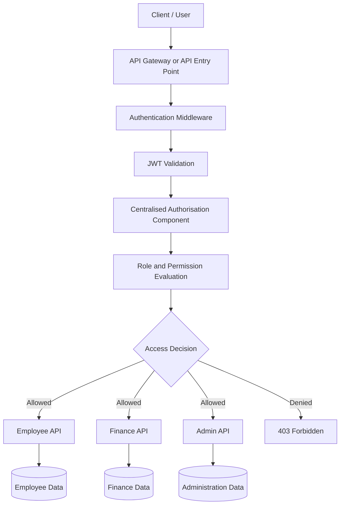

# Centralised API Authorisation

## Project Status

**Status:** Core implementation completed; security hardening and documentation improvements ongoing.

### Implemented Features

- JWT authentication and token validation
- Token expiry, issuer, audience and signature validation
- Role-Based Access Control (RBAC)
- Centralised permission enforcement
- FastAPI protected endpoints
- HTTP 401 and 403 access-control responses
- Automated unit and API integration tests

### Test Results

| Test Category | Tests Passed |
|---|---:|
| JWT Authentication | 3 |
| RBAC Authorisation | 8 |
| API Integration | 6 |
| **Total** | **17** |

All 17 automated tests passed in the local development environment.


**A reusable authentication and role-based access control (RBAC) component for securing multiple API services.**

**Project type:** Personal Cybersecurity Portfolio Project  
**Status:** In Development  
**Technology stack:** Python, FastAPI, JWT, RBAC, Pytest  
**Focus areas:** API Security | Identity and Access Management | Security Architecture | Authentication | Authorisation | Security Testing

---

## 1. Problem Statement

Modern applications often consist of multiple APIs and microservices, each responsible for different business functions.

When every API implements its own authentication and authorisation logic, security enforcement can become inconsistent. This may result in excessive privileges, unauthorised access, duplicated security logic and difficulties maintaining access-control policies.

This project addresses that challenge by designing and implementing a reusable, centralised API authorisation component.

The component will provide a consistent mechanism for validating user identities, evaluating roles and permissions, and enforcing access-control decisions across multiple API services.

### Project objectives

- Implement secure authentication using JSON Web Tokens (JWT).
- Develop a reusable Role-Based Access Control (RBAC) mechanism.
- Define granular permissions for different user roles.
- Enforce consistent authorisation across multiple APIs.
- Apply a default-deny access-control approach.
- Validate security enforcement through positive and negative tests.

## 2. Proposed Architecture

The proposed architecture consists of three API services using a shared authentication and authorisation component.

### Architecture diagram



### Architecture components

| Component | Responsibility |
|---|---|
| Client | Initiates requests to protected API endpoints. |
| API Gateway / Entry Point | Routes incoming requests to the appropriate API. |
| Authentication Middleware | Extracts and validates authentication credentials. |
| JWT Validation | Verifies token signature, expiry, issuer and audience. |
| Authorisation Component | Evaluates user roles and requested permissions. |
| Employee API | Provides authorised access to employee records. |
| Finance API | Provides authorised access to financial resources. |
| Admin API | Provides authorised administrative functions. |

The authorisation component is designed to be reusable so that each API applies the same access-control policies rather than maintaining separate implementations.

## 3. Authentication and Authorisation Flow

The application follows a two-stage security process: authentication followed by authorisation.

### Authentication flow

1. A user submits valid login credentials to the authentication service.
2. The authentication service verifies the user's identity.
3. A signed JWT is issued after successful authentication.
4. The client includes the JWT in the HTTP Authorization header when requesting protected resources.
5. Authentication middleware validates the token signature and relevant claims.
6. Requests with invalid, expired or otherwise unacceptable tokens are rejected.

### Authorisation flow

1. The authenticated user's identity and trusted role information are made available to the authorisation component.
2. The requested API endpoint identifies the permission required to perform the operation.
3. The centralised component evaluates the user's assigned permissions.
4. Access is granted only when the required permission is present.
5. Requests without the required permission are denied.
6. The decision can be recorded in security logs for monitoring and investigation.

### Example access request

```http
GET /finance/reports
Authorization: Bearer <JWT_TOKEN>
```

The Finance API requires the permission:

```text
finance:read
```

The authorisation component checks whether the authenticated user has that permission.

- If permission exists: the request proceeds.
- If permission is missing: the request is denied with HTTP 403.
- If authentication is invalid: the request is rejected with HTTP 401.

## 4. Role-Permission Matrix

The project will implement four example roles with different levels of access.

| Role | Employee API | Finance API | Admin API |
|---|---|---|---|
| Employee | Read own record | No access | No access |
| Manager | Read team records | Read reports | No access |
| Finance | No access | Read and update | No access |
| Admin | Full access | Full access | Full access |

### Proposed permission definitions

| Permission | Description |
|---|---|
| employee:read:own | Read own employee record. |
| employee:read:team | Read employee records within an authorised team. |
| employee:manage | Manage employee records. |
| finance:read | Read financial reports. |
| finance:update | Update authorised financial information. |
| admin:manage | Manage administrative resources and users. |

Permissions will be assigned to roles and evaluated centrally.

**Security principle:** Access is denied by default unless an explicit permission allows the requested action.

Note: The example role definitions are illustrative. A production implementation would also need resource-level checks, such as verifying that a manager can only access records belonging to their own team.

## 5. Security Controls

The following controls form the security baseline for the project.

| Security control | Implementation objective |
|---|---|
| JWT signature validation | Verify tokens using a trusted signing key and approved algorithm. |
| Token expiry validation | Reject expired authentication tokens. |
| Issuer validation | Verify that tokens originate from the trusted issuer. |
| Audience validation | Ensure tokens are intended for the relevant application or API. |
| RBAC | Enforce permissions based on assigned user roles. |
| Least privilege | Give users only the permissions required for their responsibilities. |
| Default deny | Reject access unless explicitly authorised. |
| Centralised enforcement | Apply common authorisation logic across all protected APIs. |
| Input validation | Validate request data and reject invalid inputs. |
| Security logging | Record relevant authentication and authorisation events without exposing secrets. |
| Error handling | Return appropriate HTTP status codes without revealing sensitive implementation details. |

### Expected HTTP responses

| Scenario | HTTP response |
|---|---|
| Successful authorised request | 200 OK |
| Missing or invalid authentication | 401 Unauthorized |
| Authenticated user lacks permission | 403 Forbidden |
| Requested resource does not exist | 404 Not Found |

## 6. Security Testing Strategy

Testing will validate both permitted and prohibited access.

The project will use Pytest to verify authentication, role assignments, permission checks and enforcement across the APIs.

### Planned test cases

| Test ID | Test scenario | Expected result | Status |
|---|---|---|---|
| AUTH-01 | Valid user accesses an authorised endpoint | Allow | Not yet executed |
| AUTH-02 | Request contains an expired JWT | Reject with 401 | Not yet executed |
| AUTH-03 | Request contains an invalid JWT signature | Reject with 401 | Not yet executed |
| AUTH-04 | Request contains no authentication token | Reject with 401 | Not yet executed |
| RBAC-01 | Employee attempts to access Finance API | Reject with 403 | Not yet executed |
| RBAC-02 | Finance user accesses financial reports | Allow | Not yet executed |
| RBAC-03 | Manager accesses authorised team records | Allow | Not yet executed |
| RBAC-04 | User attempts an operation without the required permission | Reject with 403 | Not yet executed |
| RBAC-05 | User has no assigned role | Deny by default | Not yet executed |
| API-01 | Same authorisation component protects multiple APIs | Consistent enforcement | Not yet executed |

### Test evidence

Test results will be documented after implementation.

Evidence will include:

- Test execution output.
- Successful and failed access requests.
- HTTP response codes.
- Relevant security logs.
- Screenshots of GitHub Actions test results.
- Remediation evidence for any issues identified.

No security test is considered successful until it has actually been executed and its result verified.

## 7. Repository Structure

The proposed GitHub repository structure is:

```text
centralised-api-authorisation/
│
├── README.md
│
├── docs/
│   ├── architecture.md
│   ├── requirements.md
│   └── security-decisions.md
│
├── src/
│   ├── auth/
│   │   ├── token_validation.py
│   │   ├── roles.py
│   │   ├── permissions.py
│   │   └── authorisation.py
│   │
│   ├── api/
│   │   ├── employee_api.py
│   │   ├── finance_api.py
│   │   └── admin_api.py
│   │
│   └── main.py
│
├── tests/
│   ├── test_authentication.py
│   ├── test_authorisation.py
│   └── test_api_access.py
│
├── .github/
│   └── workflows/
│       └── security-tests.yml
│
├── requirements.txt
├── .gitignore
└── LICENSE
```

## 8. Known Limitations

The current design is a learning and demonstration project. The following limitations will be considered during implementation:

- The initial RBAC model may not cover complex organisational hierarchies.
- Role-based permissions alone do not provide complete resource-level authorisation.
- Token revocation and session termination require additional design.
- The initial implementation may use a simplified identity store rather than an enterprise identity provider.
- High availability, scalability and distributed authorisation caching are outside the initial scope.
- Production key management and secret rotation require additional controls.

These limitations will be reviewed as the project evolves.

## 9. Future Improvements

Potential enhancements include:

1. **Attribute-Based Access Control (ABAC):** Introduce contextual access decisions based on attributes such as department, resource ownership and environment.
2. **Enterprise Identity Integration:** Integrate with an identity provider using OAuth 2.0 and OpenID Connect.
3. **Policy-as-Code:** Explore a policy engine such as Open Policy Agent (OPA) for more advanced authorisation decisions.
4. **Centralised Audit Logging:** Integrate security events with a SIEM platform.
5. **API Gateway Integration:** Demonstrate enforcement at both gateway and service levels.
6. **Containerisation:** Package the APIs and authorisation component using Docker.
7. **CI/CD Security Testing:** Automate unit, integration and security tests through GitHub Actions.
8. **Performance Testing:** Evaluate the impact of centralised permission evaluation on API response times.

## 10. Project Success Criteria

The project will be considered complete when:

- JWT authentication is implemented and validated.
- The RBAC model supports the defined roles and permissions.
- The authorisation component is reusable across all three APIs.
- Unauthorised requests are consistently rejected.
- Negative security tests demonstrate that access-control restrictions work.
- Test evidence is documented.
- Architecture and security decisions are clearly explained.
- The repository contains reproducible implementation and testing instructions.

## 11. Skills Demonstrated

This project is intended to demonstrate practical understanding of:

- API security architecture.
- Authentication and JWT validation.
- Identity and Access Management (IAM).
- Role-Based Access Control (RBAC).
- Least-privilege enforcement.
- Centralised security controls.
- Secure API design.
- Python and FastAPI.
- Security testing and validation.
- Technical security documentation.

---

**Disclaimer:** This is an independent portfolio project developed for learning and professional demonstration. It does not represent a production deployment or commercial implementation.
